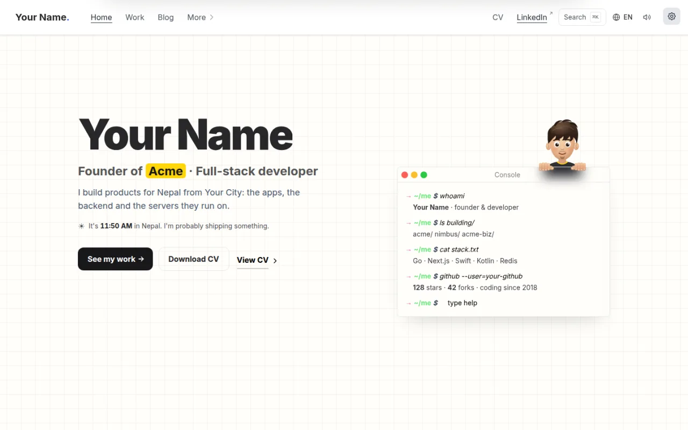
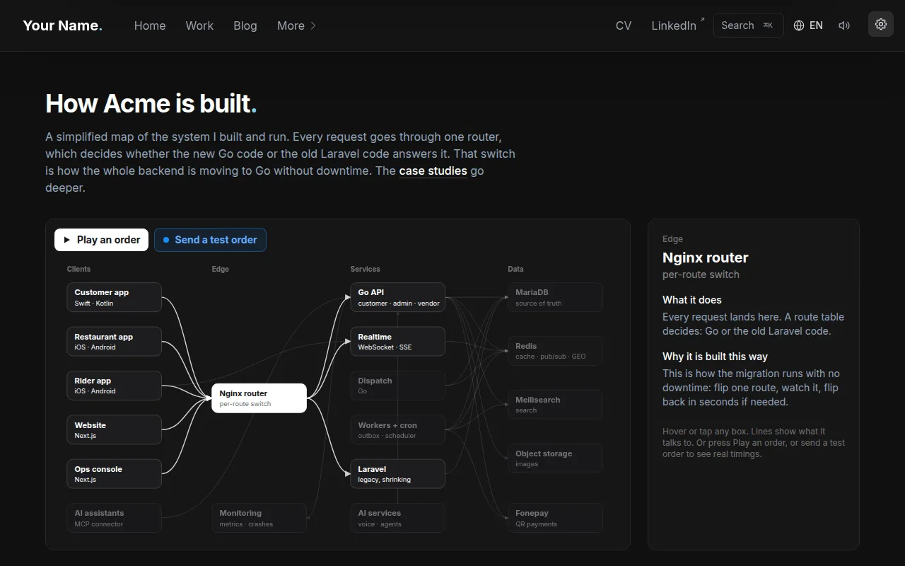
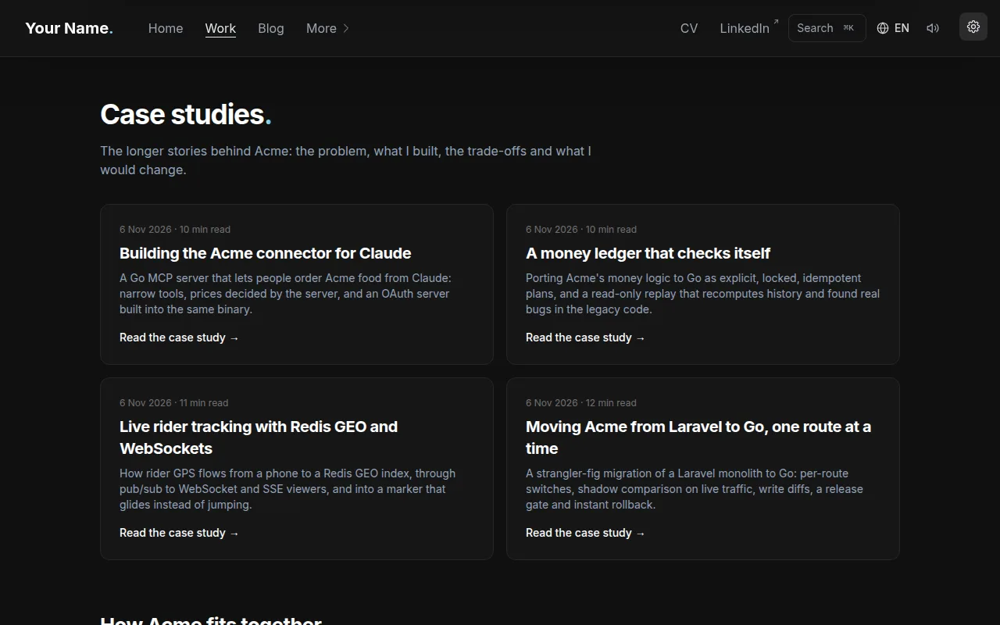
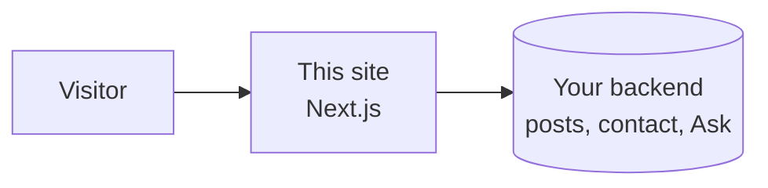

<div align="center">

<h1>Portfolio</h1>

<p><b>A personal site for developers who build real products.</b><br/>
Interactive, fast, light and dark, and built to show how you think, not just what you've made.</p>

<p>


</p>

<p>
<a href="#highlights">Highlights</a> &nbsp;·&nbsp;
<a href="#quick-start">Quick start</a> &nbsp;·&nbsp;
<a href="#make-it-yours">Make it yours</a> &nbsp;·&nbsp;
<a href="#settings">Settings</a> &nbsp;·&nbsp;
<a href="#project-layout">Project layout</a>
</p>

<br/>

<picture>
  <source media="(prefers-color-scheme: dark)" srcset=".github/readme/home-dark.webp"/>
  
</picture>

</div>

<br/>

## Highlights

<table>
<tr>
<td width="50%" valign="top">

<h3>A system map you can play</h3>
<p>Hover any box to see what it does and why it is built that way. Press <b>Play an order</b> to watch a request travel through the system, with real timings.</p>
</td>
<td width="50%" valign="top">

<h3>Case studies with live demos</h3>
<p>Long write-ups of real engineering work. Each one has a small demo next to it, so readers can try the idea instead of just reading about it.</p>
</td>
</tr>
</table>

<picture>
  <source media="(prefers-color-scheme: dark)" srcset=".github/readme/skyline-dark.webp"/>
  
</picture>
<p align="center"><sub>The footer skyline follows the local time of day: dawn, daylight, dusk and night.</sub></p>

### What else is in it

| | |
| --- | --- |
| **Typeable console** | The hero has a small terminal. Type `help`, `ls` or `cat` to explore the site. Press <kbd>`</kbd> anywhere for a full drop-down terminal. |
| **Ask** | A chat panel that answers questions about your work and shows its sources. |
| **Smart contact form** | Visitors pick a topic (hiring, a project, or just hello). A pasted job description can turn into a tailored page. |
| **Blog** | Posts with code highlighting, tags, reading time and an RSS feed. |
| **Resume** | A web resume, plus a print layout that makes a clean PDF. |
| **Polish** | Light and dark themes with a ripple switch, smooth scrolling, card-to-page transitions, a command menu (<kbd>Ctrl</kbd> <kbd>K</kbd>) and sound effects you can turn off. |
| **Every page shares well** | Link previews are drawn for each page, and search engines get structured data. |
| **Languages** | Pick a language from the menu. Strings are translated on demand. |
| **Also included** | Setup, Now, Guestbook, Status, Book a call, Code highlights and Colophon pages. |

## Quick start

You need **Node.js 18 or newer**.

```bash
git clone https://github.com/your-github/Portfolio.git
cd Portfolio
npm install
npm run dev
```

Open <http://localhost:3000>.

For a production build:

```bash
npm run build
npm start
```

## Make it yours

1. **Your details.** Edit [`config.js`](config.js): name, short bio, social links and navigation.
2. **Your pictures.** Replace the grey placeholders in [`public/`](public): `portrait.jpg`, `portrait-face.png`, `portrait-bust.png`, the icons, and the images in `public/assets/`. Keep the same file names and sizes, or update the code that uses them.
3. **Your words.** The home page text lives in [`app/page.jsx`](app/page.jsx) and [`lib/i18n.js`](lib/i18n.js). Every page has its own folder in [`app/`](app).
4. **Your content.** Blog posts, case studies, the resume, the guestbook and Ask come from a separate backend that you run yourself. It is not part of this repo. Point the site at it with `SITE_API_URL`. Without it, the site still runs and those sections stay empty.



## Settings

All settings are optional. Put them in a `.env.local` file in the project root, and never commit that file.

| Name | What it does |
| --- | --- |
| `SITE_API_URL` | Address of your backend |
| `GITHUB_ACCESS_TOKEN` | Lets the Repositories page read public GitHub data |
| `REVALIDATE_SECRET` | Protects the endpoint that refreshes cached pages |
| `HOTJAR_ID` | Optional analytics |

## Scripts

| Command | What it does |
| --- | --- |
| `npm run dev` | Start the development server |
| `npm run build` | Build for production |
| `npm start` | Serve the production build |
| `npm run lint` | Check the code |
| `npm run format` | Format the code with Prettier |
| `npm run analyze` | Build and show bundle sizes |

## Project layout

<details>
<summary>Show folders</summary>

```
app/            one folder per page (home, work, blog, architecture, resume ...)
components/
  content/        article layout and lists
  demos/          the small interactive demos used in case studies
  diagrams/       the architecture map
  elements/       header, footer, buttons, forms
  features/       bigger interactive parts: console, Ask, skyline, terminal ...
lib/            helpers: backend client, translations, link previews, markdown
public/         images, icons and fonts
styles/         global CSS
config.js       your name, links and navigation
```

</details>

## Built with

[Next.js](https://nextjs.org) · [React](https://react.dev) · [Tailwind CSS](https://tailwindcss.com) · [Headless UI](https://headlessui.com) · [Shiki](https://shiki.style) · [unified](https://unifiedjs.com) · [Inter](https://rsms.me/inter/)

## License

[MIT](license.md). Use it, change it, ship it.
